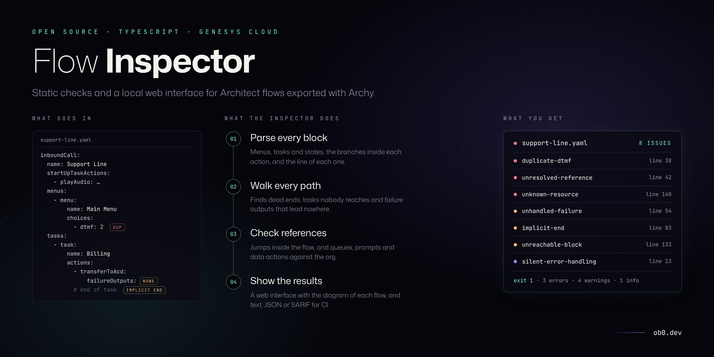
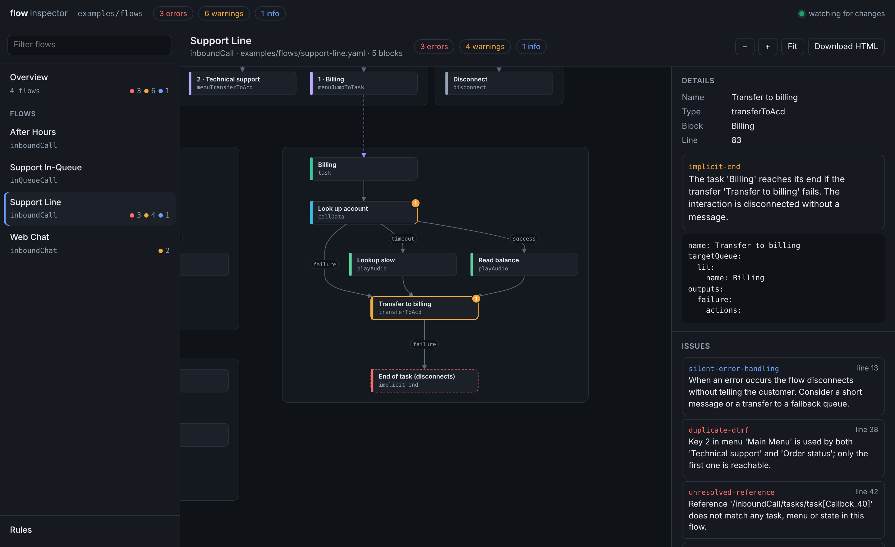
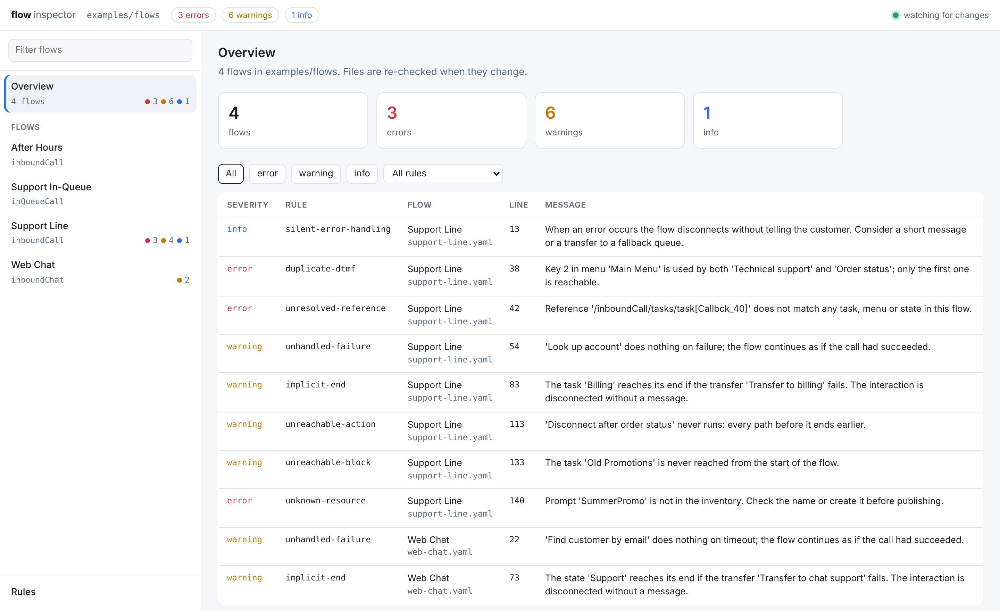

# genesys-flow-inspector

[](https://github.com/oebh2408/genesys-flow-inspector/actions/workflows/ci.yml)


Genesys Cloud Architect validates a flow when it is published, and that validation checks configuration, not paths. It will not tell you that a caller is dropped at the end of a task when a transfer fails, that a failed data action is ignored and the call carries on as if it had worked, or that two menu choices use the same key. Teams that keep their flows in Git through [Archy](https://developer.genesys.cloud/devapps/archy/) have the YAML, but nothing that reads it.

This tool reads the Archy export, follows every path through the flow and reports those problems with file and line. It runs as a local web interface that draws each flow as an interactive diagram next to its issues and updates while you edit, and as a command line tool for the terminal and CI.



<sub>`flow-inspector serve` on the flows in [examples/flows](examples/flows) (`npm run serve:example`).</sub>

## Quick start

```sh
npx github:oebh2408/genesys-flow-inspector serve flows/ --inventory inventory.json
```

Open http://localhost:4100. `flows/` is a directory of Archy YAML exports (the export command is under [Command line](#command-line)) and the inventory is optional (see [Inventory](#inventory)). To try it on the example flows:

```sh
git clone https://github.com/oebh2408/genesys-flow-inspector
cd genesys-flow-inspector
npm install
npm run serve:example
```

## What it checks

| Rule | Default | What it finds |
| --- | --- | --- |
| `unresolved-reference` | error | A jump, menu choice or `startUpRef` that points at a task, menu or state that does not exist |
| `jump-loop` | error | Tasks that jump to each other with no path that waits for input, transfers or disconnects |
| `duplicate-dtmf` | error | Two choices in the same menu bound to the same key |
| `unknown-resource` | error | A queue, prompt, data action, schedule group, flow, user, group or skill that is not in your inventory file |
| `implicit-end` | warning | A path that reaches the end of a task without an explicit disconnect or transfer, including a transfer whose failure output is empty |
| `unhandled-failure` | warning | A data action or bridge action with an empty `failure` or `timeout` output |
| `unreachable-action` | warning | Actions after a disconnect, jump or decision whose branches all end |
| `unreachable-block` | warning | A task or menu that cannot be reached from the start of the flow |
| `empty-block` | warning | A menu without choices or a task without actions |
| `silent-error-handling` | info | Flow error handling that disconnects without playing a message |

`flow-inspector rules` prints the same list.

Path analysis follows how Architect runs a flow: after an action with outputs, execution continues with the next action unless every output ended the path. A successful transfer ends the flow; a failed one continues on the failure output. `implicit-end` applies to inbound and outbound call, chat, message and email flows. `jump-loop` is skipped for in-queue flows, which loop by design.

## Install

The package is installed from GitHub; it is not published to npm.

```sh
npm install --save-dev github:oebh2408/genesys-flow-inspector
```

Or run it without installing:

```sh
npx github:oebh2408/genesys-flow-inspector lint flows/
```

Requires Node.js 18 or later.

## Web interface

```sh
npx flow-inspector serve flows/ --inventory inventory.json
```

This starts a local server on http://localhost:4100 that lints every flow in the directory and shows the results in the browser. The overview lists all issues across the flows, with filters by severity and rule; clicking one opens the flow with that node selected.



Each flow is drawn as a diagram with menus, tasks and transfers, as in the image at the top. Click a node to see its YAML and its issues, or click an issue to jump to the node. Nodes in dead code are faded, dashed purple edges are jumps between tasks and menus, and a red dashed node marks where a path ends without a disconnect or transfer. The sidebar has a page with the rules and their severities.

The page reloads the results when a flow, the inventory or the config file changes, so you can keep it open while editing or re-exporting with Archy. The server only listens on 127.0.0.1 and rejects requests with a different `Host` header. It follows the system light or dark theme.

To share one flow, use **Download HTML** in the interface or `view` from the command line. It writes a self-contained file (no scripts or fonts loaded from the network) that can be attached to a ticket or a pull request:

```sh
npx flow-inspector view flows/support-line.yaml -o support-line.html
```

## Command line

Export your flows with Archy:

```sh
archy export --flowName "Support Line" --flowType inboundcall --exportType yaml --outputDir flows/
```

Then lint a file or a directory of `.yaml` files:

```sh
npx flow-inspector lint flows/
```

Each issue has the line and column in the YAML file. The exit code is 1 when there are errors, or more warnings than `--max-warnings`.



<sub>Linting the flows in [examples/flows](examples/flows) (`npm run lint:examples`).</sub>

### Options

| Option | Description |
| --- | --- |
| `--inventory <file>` | JSON with the resources that exist in the org. Enables `unknown-resource`. |
| `--config <file>` | Config file. Defaults to `.flowinspector.json` in the current directory. |
| `--format <name>` | `text` (default), `json`, `github` (workflow annotations) or `sarif`. |
| `--max-warnings <n>` | Fail when there are more than `n` warnings. |
| `-o, --output <file>` | Output path for `view`. Defaults to the flow file name with `.html`. |
| `--port <n>` | Port for `serve`. Defaults to 4100. |

### Inventory

Names in the flow are compared with an inventory file, case-insensitive. Expressions (`exp:`) are dynamic and are not checked.

```json
{
  "queues": ["Billing", "Technical Support", "General"],
  "dataActions": ["Get Account By Phone"],
  "prompts": ["WelcomeGreeting", "MainMenu", "ClosedMessage"],
  "scheduleGroups": ["Support Hours"]
}
```

Keys can be singular or plural. Values can be plain names, objects with a `name` field, or a Platform API list response (`{ "entities": [...] }`), so you can save the output of `GET /api/v2/routing/queues` directly.

### Config

```json
{
  "inventory": "inventory.json",
  "rules": {
    "silent-error-handling": "off",
    "unreachable-block": "error"
  }
}
```

Each rule can be set to `error`, `warning`, `info` or `off`.

## In CI

GitHub Actions, with annotations on the changed lines:

```yaml
name: flows
on: [pull_request]
jobs:
  lint:
    runs-on: ubuntu-latest
    steps:
      - uses: actions/checkout@v4
      - uses: actions/setup-node@v4
        with:
          node-version: 22
      - run: npx -y github:oebh2408/genesys-flow-inspector lint flows/ --format github
```

For GitHub code scanning, use `--format sarif > results.sarif` and upload it with `github/codeql-action/upload-sarif`.

## Library

```ts
import { readFileSync } from 'node:fs';
import { inspect, renderHtml } from 'genesys-flow-inspector';

const result = inspect(readFileSync('flows/support-line.yaml', 'utf8'), {
  inventory: { queue: ['Billing', 'General'] },
  rules: { 'silent-error-handling': 'off' },
});

for (const issue of result.issues) {
  console.log(issue.loc?.line, issue.rule, issue.message);
}

const html = renderHtml(result, { source: 'support-line.yaml' });
```

`parseFlow` returns the parsed model (blocks, actions, branches, references), `analyze` returns reachability and path information, and `buildGraph` returns the nodes and edges used by the viewer, in case you want to draw them differently. `serve` and `createInspectorApp` start the web interface or return its request handler, to mount it in another server.

## Limits

- The parser follows the Archy YAML export format. Action types it does not know are kept and their branches are found from any nested `actions` list, but the rules only know the output names of common actions (decision, switch, data action, bridge, schedule evaluation, transfers).
- Bot flows and workflows are parsed and drawn, but most rules are written with call and message flows in mind.
- Loops are detected between blocks. A `loop` action inside a task is treated as running its body and then continuing.
- `unknown-resource` only checks literal names. It cannot know what an expression evaluates to.
- It does not call the Genesys Cloud API. Producing the inventory file is up to you.

## Design decisions

- [0001 · Work on the Archy export, not the API](docs/adr/0001-work-on-the-archy-export.md)
- [0002 · How paths are followed](docs/adr/0002-path-semantics.md)
- [0003 · Self-contained HTML viewer with layout computed up front](docs/adr/0003-self-contained-viewer.md)

## Development

```bash
npm install
npm test                # rules against the example flows and hand-written cases
npm run lint:examples
npm run view:example    # writes example.html
npm run demo:svg        # re-renders docs/demo.svg from the real lint output
npm run serve:example   # web interface on the example flows
npm run screenshots     # regenerates the interface images, needs a local Chromium
```

## License

MIT © [Oscar Benavides](https://ob0.dev)

Not affiliated with or endorsed by Genesys. Genesys Cloud is a trademark of its owner.
