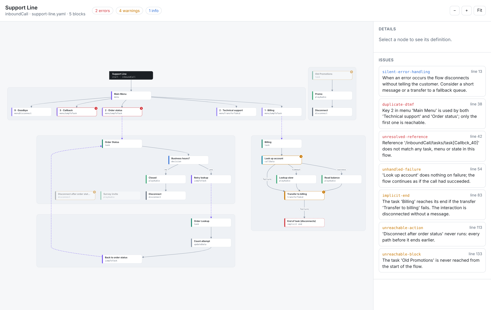
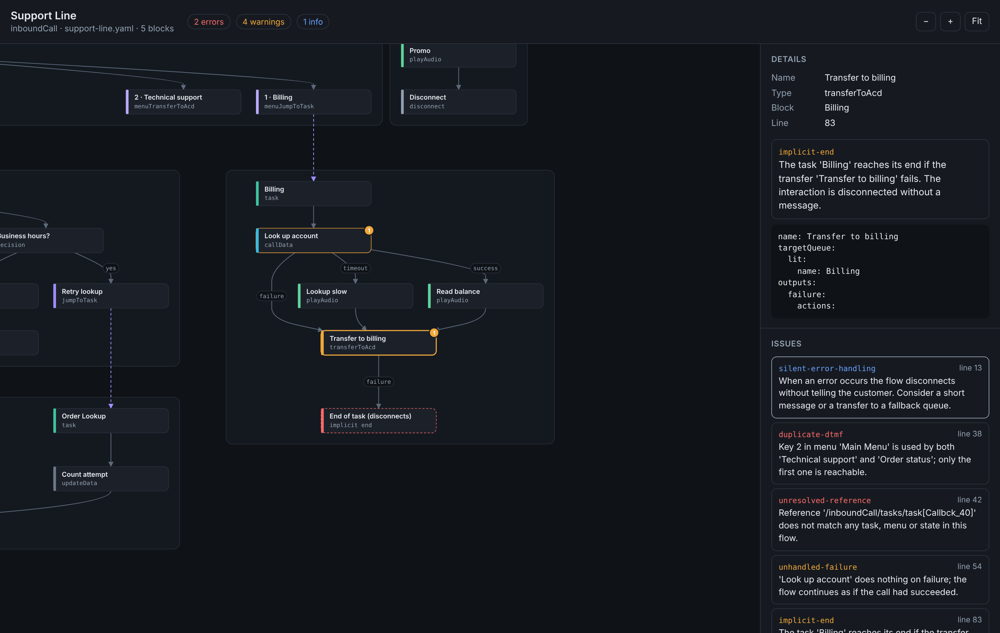

# genesys-flow-inspector

[](https://github.com/oebh2408/genesys-flow-inspector/actions/workflows/ci.yml)


Lint and visualize Genesys Cloud Architect flows exported with [Archy](https://developer.genesys.cloud/devapps/archy/).

Architect validates configuration when you publish, inside Architect. It does not follow call paths, so it will not tell you that a caller can fall off the end of a task after a failed transfer or that a data action failure is silently ignored, and it does not run on the YAML in your repository. This tool reads the Archy export, builds the call paths, and reports those problems with file and line numbers, in a terminal or in CI. It also renders the flow as an interactive diagram you can open in any browser.



## What it checks

| Rule | Default | What it finds |
| --- | --- | --- |
| `unresolved-reference` | error | A jump, menu choice or `startUpRef` that points at a task, menu or state that does not exist |
| `jump-loop` | error | Tasks that jump to each other with no path that waits for input, transfers or disconnects |
| `duplicate-dtmf` | error | Two choices in the same menu bound to the same key |
| `unknown-resource` | error | A queue, prompt, data action, schedule group, flow, user, group or skill that is not in your inventory file |
| `implicit-end` | warning | A path that reaches the end of a task without an explicit disconnect or transfer, including a transfer whose failure output is empty |
| `unhandled-failure` | warning | A data action or bridge action with an empty `failure` or `timeout` output |
| `unreachable-action` | warning | Actions after a disconnect, jump or decision whose branches all end |
| `unreachable-block` | warning | A task or menu that cannot be reached from the start of the flow |
| `empty-block` | warning | A menu without choices or a task without actions |
| `silent-error-handling` | info | Flow error handling that disconnects without playing a message |

`flow-inspector rules` prints the same list.

Path analysis follows how Architect runs a flow: after an action with outputs, execution continues with the next action unless every output ended the path. A successful transfer ends the flow; a failed one continues on the failure output. `implicit-end` applies to inbound and outbound call, chat, message and email flows. `jump-loop` is skipped for in-queue flows, which loop by design.

## Install

The package is installed from GitHub; it is not published to npm.

```sh
npm install --save-dev github:oebh2408/genesys-flow-inspector
```

Or run it without installing:

```sh
npx github:oebh2408/genesys-flow-inspector lint flows/
```

Requires Node.js 18 or later.

## Usage

Export your flows with Archy:

```sh
archy export --flowName "Support Line" --flowType inboundcall --exportType yaml --outputDir flows/
```

Then lint a file or a directory of `.yaml` files:

```sh
npx flow-inspector lint flows/
```

```text
flows/support-line.yaml
  13:3    info     When an error occurs the flow disconnects without telling the customer. ...  silent-error-handling
  38:13   error    Key 2 in menu 'Main Menu' is used by both 'Technical support' and 'Order status'; only the first one is reachable.  duplicate-dtmf
  42:13   error    Reference '/inboundCall/tasks/task[Callbck_40]' does not match any task, menu or state in this flow.  unresolved-reference
  54:13   warning  'Look up account' does nothing on failure; the flow continues as if the call had succeeded.  unhandled-failure
  83:13   warning  The task 'Billing' reaches its end if the transfer 'Transfer to billing' fails. The interaction is disconnected without a message.  implicit-end
  113:13  warning  'Disconnect after order status' never runs: every path before it ends earlier.  unreachable-action
  133:7   warning  The task 'Old Promotions' is never reached from the start of the flow.  unreachable-block

1 file checked: 2 errors, 4 warnings, 1 info
```

The exit code is 1 when there are errors, or more warnings than `--max-warnings`.

To open the diagram:

```sh
npx flow-inspector view flows/support-line.yaml -o support-line.html
```

The HTML file is self-contained (no scripts or fonts loaded from the network), so it can be attached to a ticket or a pull request. Click a node to see its definition and issues, click an issue to jump to the node. Nodes in dead code are faded; dashed purple edges are jumps between tasks and menus.



### Options

| Option | Description |
| --- | --- |
| `--inventory <file>` | JSON with the resources that exist in the org. Enables `unknown-resource`. |
| `--config <file>` | Config file. Defaults to `.flowinspector.json` in the current directory. |
| `--format <name>` | `text` (default), `json`, `github` (workflow annotations) or `sarif`. |
| `--max-warnings <n>` | Fail when there are more than `n` warnings. |
| `-o, --output <file>` | Output path for `view`. Defaults to the flow file name with `.html`. |

### Inventory

Names in the flow are compared with an inventory file, case-insensitive. Expressions (`exp:`) are dynamic and are not checked.

```json
{
  "queues": ["Billing", "Technical Support", "General"],
  "dataActions": ["Get Account By Phone"],
  "prompts": ["WelcomeGreeting", "MainMenu", "ClosedMessage"],
  "scheduleGroups": ["Support Hours"]
}
```

Keys can be singular or plural. Values can be plain names, objects with a `name` field, or a Platform API list response (`{ "entities": [...] }`), so you can save the output of `GET /api/v2/routing/queues` directly.

### Config

```json
{
  "inventory": "inventory.json",
  "rules": {
    "silent-error-handling": "off",
    "unreachable-block": "error"
  }
}
```

Each rule can be set to `error`, `warning`, `info` or `off`.

## In CI

GitHub Actions, with annotations on the changed lines:

```yaml
name: flows
on: [pull_request]
jobs:
  lint:
    runs-on: ubuntu-latest
    steps:
      - uses: actions/checkout@v4
      - uses: actions/setup-node@v4
        with:
          node-version: 22
      - run: npx -y github:oebh2408/genesys-flow-inspector lint flows/ --format github
```

For GitHub code scanning, use `--format sarif > results.sarif` and upload it with `github/codeql-action/upload-sarif`.

## Library

```ts
import { readFileSync } from 'node:fs';
import { inspect, renderHtml } from 'genesys-flow-inspector';

const result = inspect(readFileSync('flows/support-line.yaml', 'utf8'), {
  inventory: { queue: ['Billing', 'General'] },
  rules: { 'silent-error-handling': 'off' },
});

for (const issue of result.issues) {
  console.log(issue.loc?.line, issue.rule, issue.message);
}

const html = renderHtml(result, { source: 'support-line.yaml' });
```

`parseFlow` returns the parsed model (blocks, actions, branches, references), `analyze` returns reachability and path information, and `buildGraph` returns the nodes and edges used by the viewer, in case you want to draw them differently.

## Limits

- The parser follows the Archy YAML export format. Action types it does not know are kept and their branches are found from any nested `actions` list, but the rules only know the output names of common actions (decision, switch, data action, bridge, schedule evaluation, transfers).
- Bot flows and workflows are parsed and drawn, but most rules are written with call and message flows in mind.
- Loops are detected between blocks. A `loop` action inside a task is treated as running its body and then continuing.
- `unknown-resource` only checks literal names. It cannot know what an expression evaluates to.
- It does not call the Genesys Cloud API. Producing the inventory file is up to you.

## Development

```sh
npm install
npm test
npm run lint:examples
npm run view:example    # writes example.html
npm run screenshots     # regenerates docs/*.png, needs a local Chromium
```

Design notes are in [docs/adr](docs/adr).

## License

MIT
